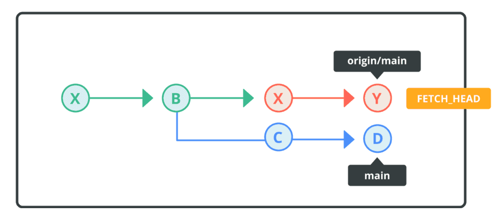
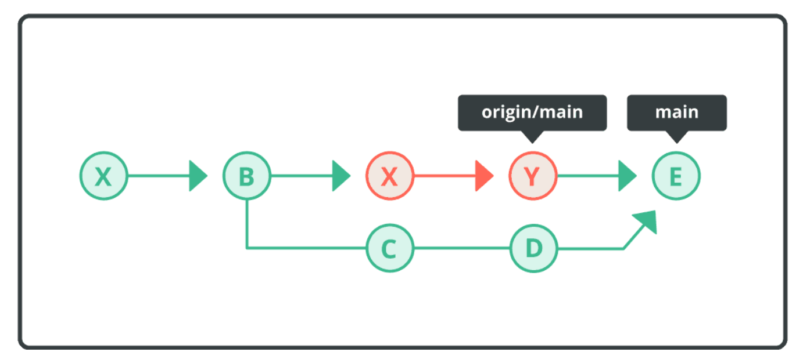
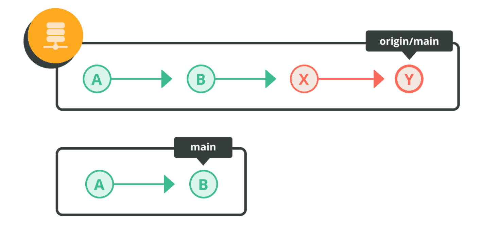
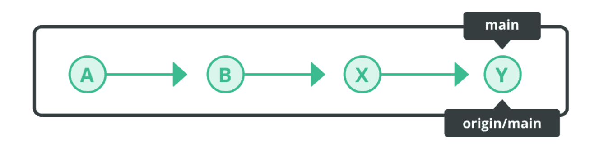
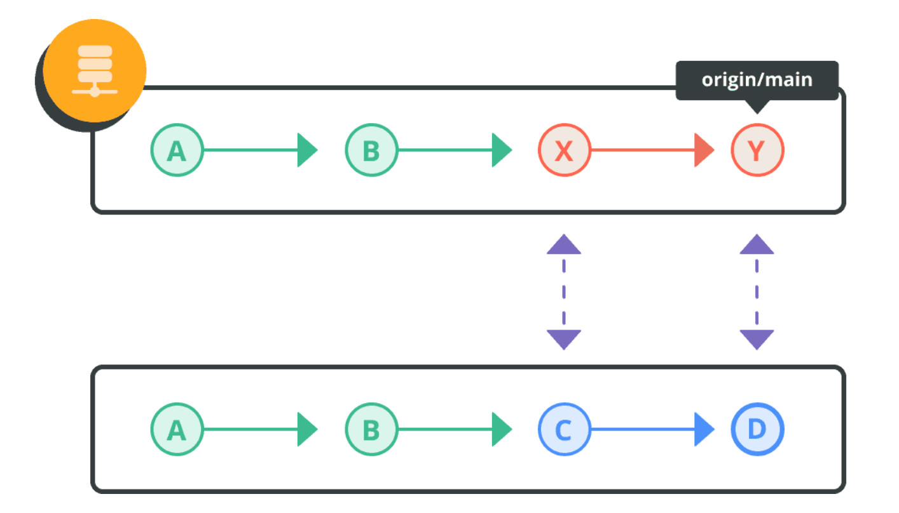
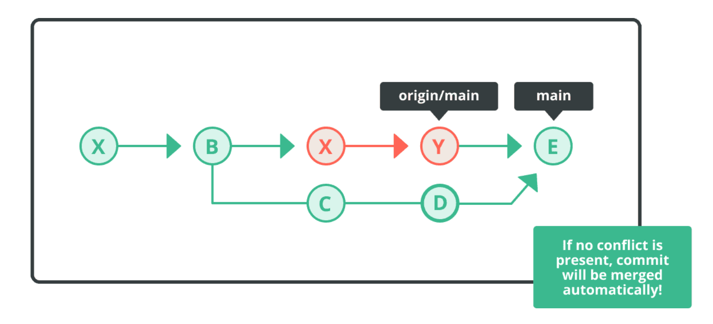

- [To-dos](#to-dos)
  - [Git config setup](#git-config-setup)
  - [Look into](#look-into)
- [Git Config](#git-config)
  - [Set username and email](#set-username-and-email)
  - [Display settings](#display-settings)
- [Basic Git](#basic-git)
  - [Show commit log](#show-commit-log)
  - [Differences](#differences)
  - [Rename files](#rename-files)
- [Undoing changes](#undoing-changes)
  - [Remove untracked files from working tree](#remove-untracked-files-from-working-tree)
  - [Discard changes in working directory](#discard-changes-in-working-directory)
  - [Unstage files](#unstage-files)
  - [Restore files to working tree](#restore-files-to-working-tree)
  - [Reverting commits](#reverting-commits)
  - [Resetting Commits](#resetting-commits)
- [Branching](#branching)
  - [List branches](#list-branches)
  - [Create a branch](#create-a-branch)
  - [Start working on a new remote branch](#start-working-on-a-new-remote-branch)
  - [Rename a branch](#rename-a-branch)
  - [Switch to branch](#switch-to-branch)
  - [Delete a branch](#delete-a-branch)
  - [Merge a branch](#merge-a-branch)
  - [Resolve a merge conflict](#resolve-a-merge-conflict)
  - [Rebase a branch](#rebase-a-branch)
- [Remote repository](#remote-repository)
  - [List remote repositories](#list-remote-repositories)
  - [Add a remote repository](#add-a-remote-repository)
  - [Push to a remote repository](#push-to-a-remote-repository)
  - [Rename local and remote branch](#rename-local-and-remote-branch)
  - [Fetching remote branches](#fetching-remote-branches)
  - [Pulling remote branches](#pulling-remote-branches)
- [Managing Git History](#managing-git-history)
  - [Amending the last commit](#amending-the-last-commit)
  - [Rebasing commits](#rebasing-commits)
  - [Squash commits](#squash-commits)
  - [Exit rebase](#exit-rebase)
- [Merging Strategies](#merging-strategies)
  - [Fast-forward merge vs. non-fast-forward merge](#fast-forward-merge-vs-non-fast-forward-merge)
  - [Rebase](#rebase)

Main source of reference [nulab](https://nulab.com/learn/software-development/git-tutorial/git-collaboration/integrating-branches/)

## To-dos

### Git config setup

- [ ] git configs explained
- [ ] git config files location
- [ ] git local config

### Look into

- [ ] Look into tagging
- [ ] Check if managing git history is done
- [ ] reflog
- [ ] stashing
- [ ] best practices - fetch
- [ ] best practices - pull


## Git Config

### Set username and email

```bash
git config --global user.name <username>
git config --global user.email <mailaddress>
```

Without the `--global` option, this setting will only apply to a specific repository.

### Display settings

```bash
git config --global --list
```

## Basic Git

### Show commit log

```bash
# Detailed logs
git log

# Shorter form
git log --oneline
```

```bash
# Commits on remote that local doesn't have
git log --oneline main..origin/main

# Commits on local that remote doesn't have
git log --oneline origin/main..main

# Visualize the two histories
git log --oneline --graph --decorate --all
```

1. `--oneline` - One line per commit
2. `--graph` - Draw a graph
3. `--all` - All refs
4. `--decorate` - displays references (names) attached to commits, such as branch names, tags, and `HEAD`

The log will, by default, show a list of commits of the current branch.

### Differences

Local diffs

```bash
# Show all differences
git diff

#Show file names only
git diff --name-only

# Show only staged changes
git diff --staged
```

Remote diffs

```bash
# Compare local vs remote
git diff main..origin/main

# Compare your current branch with its upstream
git diff HEAD..@{upstream}
```

git diff **main..origin/main** - The order determines which changes appear with `-` and which appear with `+`.

`git diff main..origin/main` - Compares local main -> remote-tracking origin/main.

- `-` lines: in `main`, removed in `origin/main`.
- `+` lines: in `origin/main`, added compared with `main`.

`git diff origin/main..main` - Compares remote-tracking origin/main -> local main.

- `-` lines: in `origin/main`, removed in `main`.
- `+` lines: in `main`, added compared with `origin/main`.

### Rename files

```bash
git mv <oldfilename> <newfilename>
```

## Undoing changes

### Remove untracked files from working tree

```bash
git clean
```

Adding the `-n` option will only show the files that will be removed. Adding the `-f` option will actually remove the files.

By default, files listed under the .gitignore configuration file will not be removed. If you specify the `-x` option, however, the files listed under “.gitignore” will be removed from the working tree.

### Discard changes in working directory

```bash
git restore <file>
```

### Unstage files

```bash
git restore --staged <file>
```

### Restore files to working tree

```bash
git checkout -- <file>
```

### Reverting commits

Use the `git revert` command to undo previous commits. This is the most common method of undoing changes.

The revert command creates a new commit that reverts the changes made by a previous commit.


```bash
git revert HEAD
git revert HEAD~1 #
```

`HEAD~1` means the parent of the commit you're currently on — in other words, one commit before your current commit.

The git revert command takes a commit as an argument and creates a new commit that undoes the changes made by that commit.

### Resetting Commits

Use the `git reset` command to make the `HEAD` point to a previous commit. You can specify the scope for the reset command by going into reset mode.

Used primarily **to undo local commits that have not yet been pushed to a remote repository**.


Three primary modes: `--soft`, `--mixed`, and `--hard`

| Mode name | Index | Work tree |
|:---------:|:-----:|:---------:|
| soft | unchanged | unchanged |
| mixed (default) | change | unchanged |
| hard | change | change |

## Branching

### List branches

```bash
# List local branches
git branch
# List all branches inc. remotes
git branch -a
```

### Create a branch

```bash
git branch <name> # without switching to it
git switch -c <name> # create and switch to new branch
```

### Start working on a new remote branch

To create a local branch that tracks the remote branch:

```bash
git switch --track origin/<branch>
```

If you want to fetch and then switch to a newly discovered branch, use:

```bash
git fetch origin
git switch --track origin/<branch>
```

### Rename a branch

```bash
git branch -m <new_name> # refuses if a branch named <new_name> already exists.
git branch -M <new_name> # forces the rename even if <new_name> already exists.
```

### Switch to branch

```bash
git checkout <name>
git switch <name>
```

### Delete a branch

```bash
git branch -d <branch_name> # deletes branch safely
git branch -D <branch_name> # force-deletes branch
```

### Merge a branch

Merging creates a new commit that combines the changes from one branch into another branch.

Switch to the branch you want to merge into and then:

```bash
git merge <branch_name>
```

### Resolve a merge conflict

When Git has identified a conflict, you will find markers added to the file by Git with information regarding the conflict. We must manually fix the conflict and commit.

### Rebase a branch

Rebasing moves a sequence of commits from one branch to another by replaying them on top of the target branch.

Switch to the branch you want to update then run:

```bash
git rebase <branch>
```

```bash
git rebase --abort
```

By adding the `--abort` option, you can exit the rebase operation.


## Remote repository

### List remote repositories

```bash
git remote
git remote -v # Detailed version
```

### Add a remote repository

```bash
git remote add origin <link>
```

1. `git remote` - Manage connections to remote repositories.
2. `add` - Add a new remote connection.
3. `origin` - The name you give that remote connection.
4. `<link>` - The URL of the remote repository.

### Push to a remote repository

```bash
git push -u origin main
```
1. `git push` - Upload your local commits to a remote repository.
2. `-u` - Short for `--set-upstream`. - Sets the upstream branch for your local branch, telling Git which remote branch it should track by default.
3. `origin` - The name of your remote repository.
4. `main` - The local branch you want to push.

> [!NOTE]
> **remote branch** is a branch on the remote repository
>
> **upstream branch** is the remote branch that your local branch is configured to track.
>
> `-u` tells Git to save the tracking relationship after the push succeeds.

### Rename local and remote branch

Rename local branch

```bash
git branch -m <new_name>
```

Push branch to remote repository

```bash
git push -u origin my_feature
```

Delete old branch

```bash
git push origin --delete <old_name>
```

### Fetching remote branches

If you want to obtain the remote changes but not have them merged into your current local branch, you can execute the `git fetch` command.

Fetch will download changes from the remote that do not yet exist on your local branch. The `FETCH_HEAD ref` will track the fetched changes from the remote repository.

When both the remote and local branches contain different descendants, the revision history will look like this:



Once changes are fetched, you can apply those changes to your local repository by merging in `FETCH_HEAD` or executing a pull.



Once `FETCH_HEAD` has merged, the revision history will yield the same result as a git pull operation.

**Fetch remote changes**

```bash
git fetch origin
```

**Inspect the fetched changes**

```bash
git log --oneline HEAD..FETCH_HEAD
git diff HEAD..FETCH_HEAD
```

**Merge the fetched changes into your current branch**

```bash
git merge FETCH_HEAD
```

### Pulling remote branches

The `git pull` command fetches new commits from a remote branch and integrates them into your current local branch.

> [!WARNING]
> This updates the current branch from its configured upstream. It does not automatically create local branches for every new remote branch.

Say the remote branch is upstream of your local branch. The remote branch would include all of the local branch's changes.



In this case, if we were to apply a merge from the remote branch (origin/main) into our local branch (main), it would be a fast-forward merge.



However, if there are changes in the local main branch are not present in the remote origin/main branch, the pull command will execute a merge and create a merge commit that ties those changes together.



A merge commit is automatically created in the local repository when executing a pull. If there is a conflict, you will have to resolve the conflict and commit the merge manually.



## Managing Git History

### Amending the last commit

```bash
git commit --amend
```

### Rebasing commits

Rebasing in Git is a process that allows you to move or combine a sequence of commits to a new base commit. This can be particularly useful for integrating changes from one branch into another cleanly.

```bash
git rebase -i <commit>
```

Add a commit hash and a list of all commits up to the latest commit will be listed. Find the commit you wish to modify, and change that line from `pick` to `edit` then save and quit.

Next, add the `--amend` option to commit. A screen for adding a message will be displayed. Modify the message.

```bash
git commit --amend
```

Finally, add the `--continue` option to run rebase.

```bash
git rebase --continue
```

### Squash commits

```bash
git rebase -i <commit>
```

Add `squash` to commits you want to squash. Those commits marked with `squash` will merge into the first one marked with `pick`

### Exit rebase

```bash
git rebase --abort
```

By adding the `--abort` option, you can exit the rebase operation.

## Merging Strategies

The most important thing to understand first: **Git branches are pointers to commits, and commits form a history**. Merging and rebasing are two different ways of combining work from different branches.

We'll use this notation throughout:

- `A`, `B`, `C` = commits.
- `main`, `feature` = branch names pointing to commits.
- `*` = a merge commit.
- `HEAD` = where you currently are in Git.
- Lines show the history connecting commits.

### Fast-forward merge vs. non-fast-forward merge

Imagine you start with this history:

```
A---B---C  main
```

You create a feature branch at C and make two commits on it:

```
A---B---C  main
         \
          D---E  feature
```

Here, `main` still points to `C`, while `feature` points to `E`.

You've finished your feature and want to merge it into `main`. There are two possible outcomes.

**A. Fast-forward merge `--ff`**

A fast-forward merge is possible when the branch you're merging into has **not moved forward independently** since you branched off.

Before merging:

```
A---B---C  main
         \
          D---E  feature
```

Run:

```bash
git switch main
git merge feature
```

After merging:

```
A---B---C---D---E  main, feature
```

> [!IMPORTANT]
> Git simply moves the main pointer forward from `C` to `E`. No new commit is created.

**B. Non-fast-forward merge `--no-ff`**

Now suppose you want to preserve a visible record that the feature branch was merged, even when a fast-forward would have been possible.

Starting from the same history:

```
A---B---C  main
         \
          D---E  feature
```

Run:

```bash
git switch main
git merge --no-ff feature
```

The result looks like this:

```
A---B---C-------M  main
         \     /
          D---E  feature
```

`M` is a merge commit. It has two parents: `C` and `E`.

> [!IMPORTANT]
> Git created a new commit to record the merge, even though it could have moved main forward without one.

Why do this? It can make it easier to see where a feature began and where it was integrated into main.

**What if both branches have moved?**

This is the situation where a merge commit is often necessary.

Suppose someone adds `X` to `main` while you're working on `feature`:

```
          D---E  feature
         /
A---B---C---X  main
```

The two branches have diverged. Neither branch is simply ahead of the other.

Run:

```bash
git switch main
git merge feature
```

Git combines the histories by creating a merge commit:

```
          D---E
         /     \
A---B---C---X---M  main
```

Here, `M` has parents `X` and `E`. The merge commit records both lines of development.

**Key distinction**: `--no-ff` forces a merge commit when a fast-forward would otherwise be possible. If branches have diverged, Git normally needs a merge commit anyway, regardless of `--no-ff`.

### Rebase

Rebase takes your feature branch's commits and **replays them on top of another commit**, creating new commits with new IDs.

**The branches diverge**

You created `feature` from `C`, but `main` has moved forward with commit `X`.

```
          D---E  feature
         /
A---B---C---X  main
```

**Rebase feature onto main**

Run:

```bash
git switch feature
git rebase main
```

> [!NOTE]
> In plain English:
>
> Take my `feature` commits and replay them on top of the latest commit on `main`.
>
> Git takes the changes introduced by `D` and `E` and reapplies them on top of `X`.

Before:

```
          D---E  feature
         /
A---B---C---X  main
```

After:

```
A---B---C---X  main
             \
              D'---E'  feature
```

**Notice `D'` and `E'` instead of `D` and `E`.**

These are **new commits**. They contain the replayed changes from the original commits, but their parent commits have changed, so their commit IDs change too.

The original commits `D` and `E` aren't immediately deleted; they simply aren't part of the feature branch's new history.

> [!IMPORTANT]
> Why is this useful?
>
> Your feature now appears to have been developed after `X`. The history is linear, without a merge commit.

**Merge the rebased feature into main**

Run:

```bash
git switch main
git merge feature
```

The result is:

```
A---B---C---X---D'---E'  main, feature
```
