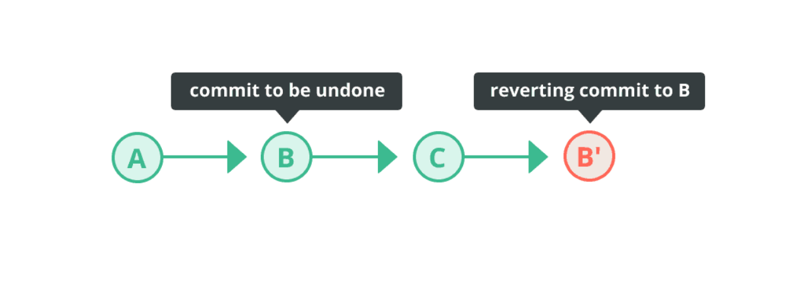
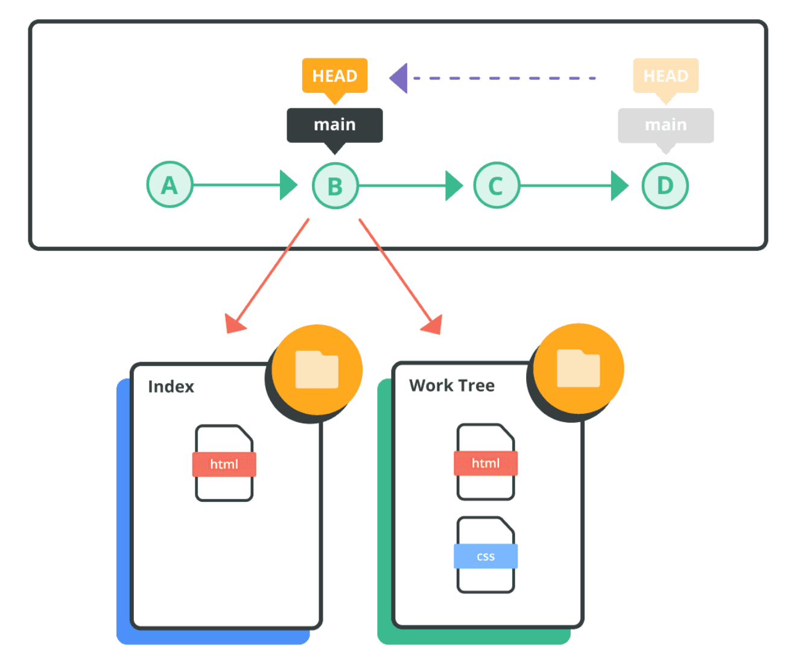

- [Checklist](#checklist)
  - [Git config setup](#git-config-setup)
  - [Look into](#look-into)
- [Git Config](#git-config)
  - [Set username and email](#set-username-and-email)
  - [Display settings](#display-settings)
- [Basic Git](#basic-git)
  - [Show commit log](#show-commit-log)
  - [Rename files](#rename-files)
- [Undoing changes](#undoing-changes)
  - [Remove untracked files from working tree](#remove-untracked-files-from-working-tree)
  - [Discard changes in working directory](#discard-changes-in-working-directory)
  - [Unstage files](#unstage-files)
  - [Restore files to working tree](#restore-files-to-working-tree)
  - [Reverting commits](#reverting-commits)
  - [Resetting Commits](#resetting-commits)
- [Branching](#branching)
  - [List branches](#list-branches)
  - [Create a branch](#create-a-branch)
  - [Rename a branch](#rename-a-branch)
  - [Switch to branch](#switch-to-branch)
  - [Delete a branch](#delete-a-branch)
  - [Merge a branch](#merge-a-branch)
  - [Resolve a merge conflict](#resolve-a-merge-conflict)
  - [Rebase a branch](#rebase-a-branch)
- [Remote repository](#remote-repository)
  - [List remote repositories](#list-remote-repositories)
  - [Add a remote repository](#add-a-remote-repository)
  - [Push to a remote repository](#push-to-a-remote-repository)
  - [Rename local and remote branch](#rename-local-and-remote-branch)

Main source of reference [nulab](https://nulab.com/learn/software-development/git-tutorial/git-collaboration/integrating-branches/)


## Checklist

### Git config setup

- [ ] git configs explained
- [ ] git config files location

### Look into

- [ ] Look into tagging
- [ ] Managing git history
- [ ] reflog

## Git Config

### Set username and email

```bash
git config --global user.name <username>
git config --global user.email <mailaddress>
```

Without the `--global` option, this setting will only apply to a specific repository.

### Display settings

```bash
git config --global --list
```

## Basic Git

### Show commit log

```bash
git log # Detailed logs
git log --oneline # Shorter form
```

The log will, by default, show a list of commits of the current branch.

### Rename files

```bash
git mv <oldfilename> <newfilename>
```

## Undoing changes

### Remove untracked files from working tree

```bash
git clean
```

Adding the `-n` option will only show the files that will be removed. Adding the `-f` option will actually remove the files.

By default, files listed under the .gitignore configuration file will not be removed. If you specify the `-x` option, however, the files listed under “.gitignore” will be removed from the working tree.

### Discard changes in working directory

```bash
git restore <file>
```

### Unstage files

```bash
git restore --staged <file>
```

### Restore files to working tree

```bash
git checkout -- <file>
```

### Reverting commits

Use the `git revert` command to undo previous commits. This is the most common method of undoing changes.

The revert command creates a new commit that reverts the changes made by a previous commit.



```bash
git revert HEAD
git revert HEAD~1 #
```

`HEAD~1` means the parent of the commit you're currently on — in other words, one commit before your current commit.

The git revert command takes a commit as an argument and creates a new commit that undoes the changes made by that commit.

### Resetting Commits

Use the `git reset` command to make the `HEAD` point to a previous commit. You can specify the scope for the reset command by going into reset mode.

Used primarily **to undo local commits that have not yet been pushed to a remote repository**.



Three primary modes: `--soft`, `--mixed`, and `--hard`

| Mode name | Index | Work tree |
|:---------:|:-----:|:---------:|
| soft | unchanged | unchanged |
| mixed (default) | change | unchanged |
| hard | change | change |

## Branching

### List branches

```bash
git branch
```

### Create a branch

```bash
git branch <name> # without switching to it
git switch -c <name> # create and switch to new branch
```

### Rename a branch

```bash
git branch -m <new_name> # refuses if a branch named <new_name> already exists.
git branch -M <new_name> # forces the rename even if <new_name> already exists.
```

### Switch to branch

```bash
git checkout <name>
git switch <name>
```

### Delete a branch

```bash
git branch -d <branch_name> # deletes branch safely
git branch -D <branch_name> # force-deletes branch
```

### Merge a branch

Merging creates a new commit that combines the changes from one branch into another branch.

Switch to the branch you want to merge into and then:

```bash
git merge <branch_name>
```

### Resolve a merge conflict

When Git has identified a conflict, you will find markers added to the file by Git with information regarding the conflict. We must manually fix the conflict and commit.

### Rebase a branch

Rebasing moves a sequence of commits from one branch to another by replaying them on top of the target branch.

## Remote repository

### List remote repositories

```bash
git remote
git remote -v # Detailed version
```

### Add a remote repository

```bash
git remote add origin <link>
```

1. `git remote` - Manage connections to remote repositories.
2. `add` - Add a new remote connection.
3. `origin` - The name you give that remote connection.
4. `<link>` - The URL of the remote repository.

### Push to a remote repository

```bash
git push -u origin main
```
1. `git push` - Upload your local commits to a remote repository.
2. `-u` - Short for `--set-upstream`. - Sets the upstream branch for your local branch, telling Git which remote branch it should track by default.
3. `origin` - The name of your remote repository.
4. `main` - The local branch you want to push.

> [!NOTE]
> **remote branch** is a branch on the remote repository
>
> **upstream branch** is the remote branch that your local branch is configured to track.
>
> `-u` tells Git to save the tracking relationship after the push succeeds.

### Rename local and remote branch

Rename local branch

```bash
git branch -m <new_name>
```

Push branch to remote repository

```bash
git push -u origin my_feature
```

Delete old branch

```bash
git push origin --delete <old_name>
```
