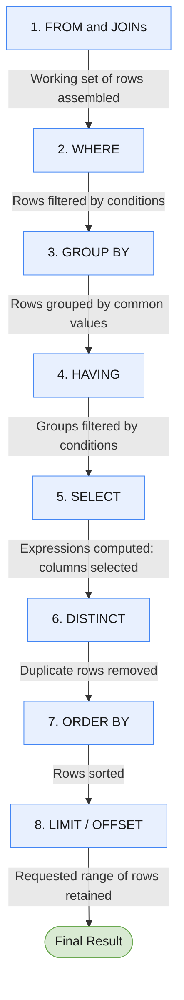

- [Todo](#todo)
- [Key Concepts](#key-concepts)
- [Order of execution of a Query](#order-of-execution-of-a-query)
- [Data Definition Language](#data-definition-language)
  - [CREATE](#create)
    - [Create Table](#create-table)
  - [DROP](#drop)
    - [Drop Table](#drop-table)
  - [TRUNCATE](#truncate)
  - [ALTER](#alter)
    - [Rename Database/Table](#rename-databasetable)
    - [Add Column to Existing Table](#add-column-to-existing-table)
    - [Drop a Column From an Existing Table](#drop-a-column-from-an-existing-table)
    - [Add a Column With a Constraint](#add-a-column-with-a-constraint)
    - [Add a Primary Key to a Table](#add-a-primary-key-to-a-table)
    - [Add a Foreign Key Column](#add-a-foreign-key-column)
    - [Drop a Constraint](#drop-a-constraint)
- [Data Manipulation Language](#data-manipulation-language)
  - [SELECT](#select)
  - [Queries with constraints](#queries-with-constraints)
    - [WHERE](#where)
    - [Operators](#operators)
  - [Filtering and sorting Query results](#filtering-and-sorting-query-results)
    - [DISTINCT](#distinct)
    - [ORDER BY](#order-by)
    - [LIMIT \& OFFSET](#limit--offset)
  - [Queries with aggregates](#queries-with-aggregates)
    - [Common aggregate functions](#common-aggregate-functions)
    - [GROUP BY](#group-by)
    - [HAVING](#having)
  - [JOINs](#joins)
    - [INNER JOIN](#inner-join)
    - [OUTER JOINs](#outer-joins)
  - [INSERT](#insert)
  - [UPDATE](#update)
  - [DELETE](#delete)
- [psql](#psql)
  - [Login Command](#login-command)
  - [List All Databases](#list-all-databases)
  - [Connect to Database](#connect-to-database)
  - [Create a Database](#create-a-database)
  - [List All Relations](#list-all-relations)
  - [List All Tables](#list-all-tables)
  - [Display schema/structure of a table](#display-schemastructure-of-a-table)
  - [Quit](#quit)


## Todo

- [ ] Constraints
- [ ] Data Types
- [ ] Subqueries

## Key Concepts

**Relational Databases**: Organize data into related tables made of rows and columns. Each row represents a **record**, and each column represents an **attribute** of the data.

**Schema**: A relational database requires a schema that defines its structure—tables, columns, data types, constraints, and relationships.

**Primary Keys**: Unique identifiers for each row in a table. They are essential for data integrity and are used to relate records between tables via foreign keys.

**Foreign Keys**: References to primary keys in another table, used to link related data across tables.

**Relationships**: By connecting tables through primary and foreign keys, you can structure normalized data and perform meaningful queries.

**Entity Relationship Diagrams (ERDs)**: Visualize how entities (tables) relate to each other in a database schema.

**Data Integrity**: Enforced using keys and data types. Ensures consistency and accuracy of stored data.

**RDBMS**: Relational Database Management Systems

**DDL**: Data Definition Language is a subset of SQL used to define and manage the structure of database objects.

**DML**: Data Manipulation Language (DML) is a subset of SQL used to manage data within database objects.

## Order of execution of a Query

```postgres
SELECT DISTINCT column, AGG_FUNC(column_or_expression), …
FROM mytable
    JOIN another_table
      ON mytable.column = another_table.column
    WHERE constraint_expression
    GROUP BY column
    HAVING constraint_expression
    ORDER BY column ASC/DESC
    LIMIT count OFFSET COUNT;
```



Each query begins with **finding** the data that we need in a database, and then **filtering** that data down into something that can be processed and understood as quickly as possible.

**1. FROM and JOINs**

The `FROM` clause, and subsequent `JOINs` are first executed to determine the total working set of data that is being queried. This includes subqueries in this clause, and can cause temporary tables to be created under the hood containing all the columns and rows of the tables being joined.

**2. WHERE**

Once we have the total working set of data, the first-pass `WHERE` constraints are applied to the individual rows, and rows that do not satisfy the constraint are discarded. Each of the constraints can only access columns directly from the tables requested in the `FROM` clause. Aliases in the SELECT part of the query are not accessible in most databases since they may include expressions dependent on parts of the query that have not yet executed.

**3. GROUP BY**

The remaining rows after the `WHERE` constraints are applied are then grouped based on common values in the column specified in the `GROUP BY` clause. As a result of the grouping, there will only be as many rows as there are unique values in that column. Implicitly, this means that you should only need to use this when you have aggregate functions in your query.

**4. HAVING**

If the query has a `GROUP BY` clause, then the constraints in the `HAVING` clause are then applied to the grouped rows, discard the grouped rows that don't satisfy the constraint. Like the `WHERE` clause, aliases are also not accessible from this step in most databases.

**5. SELECT**

Any expressions in the `SELECT` part of the query are finally computed.

**6. DISTINCT**

Of the remaining rows, rows with duplicate values in the column marked as `DISTINCT` will be discarded.

**7. ORDER BY**

If an order is specified by the `ORDER BY` clause, the rows are then sorted by the specified data in either ascending or descending order. Since all the expressions in the `SELECT` part of the query have been computed, you can reference aliases in this clause.

**8. LIMIT / OFFSET**

Finally, the rows that fall outside the range specified by the `LIMIT` and `OFFSET` are discarded, leaving the final set of rows to be returned from the query.

## Data Definition Language

### CREATE

#### Create Table

```postgres
CREATE TABLE IF NOT EXISTS table_name (
  column_name BIGINT GENERATED ALWAYS AS IDENTITY PRIMARY KEY,
  column_name VARCHAR(100) NOT NULL UNIQUE
);
```

OR

```postgres
CREATE TABLE table_name();
```

### DROP

#### Drop Table

```postgres
DROP TABLE table_name;
```

### TRUNCATE

Remove All Records From a Table

```postgres
TRUNCATE TABLE table_name;
```

### ALTER

#### Rename Database/Table

```postgres
ALTER DATABASE database_name RENAME TO new_database_name;
```

```postgres
ALTER TABLE table_name RENAME COLUMN column_name TO new_name;
```

#### Add Column to Existing Table

```postgres
ALTER TABLE table_name ADD COLUMN column_name DATATYPE;
```

#### Drop a Column From an Existing Table

```postgres
ALTER TABLE table_name DROP COLUMN column_name;
```

#### Add a Column With a Constraint

```postgres
ALTER TABLE table_name ADD COLUMN column_name DATATYPE CONSTRAINT;
```

#### Add a Primary Key to a Table

```postgres
ALTER TABLE table_name ADD PRIMARY KEY(column_name);
```

#### Add a Foreign Key Column

```postgres
ALTER TABLE table_name ADD COLUMN column_name DATATYPE REFERENCES referenced_table_name(referenced_column_name);
```

#### Drop a Constraint

```postgres
ALTER TABLE table_name DROP CONSTRAINT constraint_name;
```

## Data Manipulation Language

### SELECT

```postgres
SELECT column, another_column, …
FROM mytable;
```

```postgres
SELECT *
FROM mytable;
```

### Queries with constraints

#### WHERE

```postgres
SELECT column, another_column, …
FROM mytable
WHERE condition
    AND/OR another_condition
    AND/OR …;
```
#### Operators

|       Operator      | Condition                                            | SQL Example                   |
|:-------------------:|------------------------------------------------------|-------------------------------|
| =, !=, <, <=, >, >= | Standard numerical operators                         | `col_name != 4`               |
| BETWEEN … AND …     | Number is within range of two values (inclusive)     | `col_name BETWEEN 1.5 AND 10.5` |
| NOT BETWEEN … AND … | Number is not within range of two values (inclusive) | `col_name NOT BETWEEN 1 AND 10` |
| IN (…)              | Number exists in a list                              | `col_name IN (2, 4, 6)`       |
| NOT IN (…)          | Number does not exist in a list                      | `col_name NOT IN (1, 3, 5)`   |

| Operator      | Condition                                                                                 | Example |
|:-------------:|--------------------------------------------------------------------------------------------|---------|
| `=`           | Case-sensitive exact string comparison (depending on database/collation)                  | `col_name = 'abc'` |
| `!=` or `<>`  | String inequality comparison                                                              | `col_name != 'abcd'` |
| `LIKE`        | Pattern matching; case sensitivity depends on database/collation                            | `col_name LIKE 'ABC'` |
| `NOT LIKE`    | Negated pattern matching; case sensitivity depends on database/collation                   | `col_name NOT LIKE 'ABCD'` |
| `ILIKE`       | Case-insensitive pattern matching (PostgreSQL-specific)                                   | `col_name ILIKE 'abc'` |
| `NOT ILIKE`   | Case-insensitive negated pattern matching (PostgreSQL-specific)                            | `col_name NOT ILIKE 'abc'` |
| `%`           | Matches a sequence of zero or more characters (used with `LIKE`, `ILIKE`, etc.)            | `col_name LIKE '%AT%'` (matches `'AT'`, `'ATTIC'`, `'CAT'`, or `'BATS'`) |
| `_`           | Matches exactly one character (used with `LIKE`, `ILIKE`, etc.)                            | `col_name LIKE 'AN_'` (matches `'AND'`, but not `'AN'`) |
| `IN (…)`      | Checks whether a string matches any value in a list                                       | `col_name IN ('A', 'B', 'C')` |
| `NOT IN (…)`  | Checks whether a string matches none of the values in a list                              | `col_name NOT IN ('D', 'E', 'F')` |


### Filtering and sorting Query results

#### DISTINCT

The `DISTINCT` keyword will blindly remove duplicate rows, to discard duplicates based on specific columns use grouping and the GROUP BY clause.

```postgres
SELECT DISTINCT column, another_column, …
FROM mytable
WHERE condition(s);
```

#### ORDER BY

```postgres
SELECT column, another_column, …
FROM mytable
WHERE condition(s)
ORDER BY column ASC/DESC;
```

#### LIMIT & OFFSET

```postgres
SELECT column, another_column, …
FROM mytable
WHERE condition(s)
ORDER BY column ASC/DESC
LIMIT num_limit OFFSET num_offset;
```

### Queries with aggregates

```postgres
SELECT AGG_FUNC(column_or_expression) AS aggregate_description, …
FROM mytable
WHERE constraint_expression;
```

#### Common aggregate functions

| Function                        | Description |
|---------------------------------|-------------|
| `COUNT(*)`, `COUNT(column)`     | Counts the number of rows in the group if `*` is specified. Otherwise, counts the number of rows with non-`NULL` values in the specified column. |
| `MIN(column)`                   | Finds the smallest numerical value in the specified column for all rows in the group. |
| `MAX(column)`                   | Finds the largest numerical value in the specified column for all rows in the group. |
| `AVG(column)`                   | Finds the average numerical value in the specified column for all rows in the group. |
| `SUM(column)`                   | Finds the sum of all numerical values in the specified column for all rows in the group. |

#### GROUP BY

The `GROUP BY` clause works by grouping rows that have the same value in the column specified.

```postgres
SELECT AGG_FUNC(column_or_expression) AS aggregate_description, …
FROM mytable
WHERE constraint_expression
GROUP BY column;
```

#### HAVING

`HAVING` clause: used specifically with the `GROUP BY` clause to allow us to filter grouped rows from the result set.

The `HAVING` clause constraints are written the same way as the `WHERE` clause constraints, and are applied to the grouped rows.

```postgres
SELECT group_by_column, AGG_FUNC(column_expression) AS aggregate_result_alias, …
FROM mytable
WHERE condition
GROUP BY column
HAVING group_condition;
```

### JOINs

#### INNER JOIN

Returns only rows that have matching values in both tables.

```postgres
SELECT column, another_table_column, …
FROM mytable
INNER JOIN another_table
    ON mytable.id = another_table.id
WHERE condition(s)
ORDER BY column, … ASC/DESC
LIMIT num_limit OFFSET num_offset;
```

#### OUTER JOINs

When joining table A to table B:

1. a **LEFT JOIN** simply includes rows from A regardless of whether a matching row is found in B.
2. The **RIGHT JOIN** is the same, but reversed, keeping rows in B regardless of whether a match is found in A.
3.  Finally, a **FULL JOIN** simply means that rows from both tables are kept, regardless of whether a matching row exists in the other table.

```sql
SELECT column, another_column, …
FROM mytable
INNER/LEFT/RIGHT/FULL JOIN another_table
    ON mytable.id = another_table.matching_id
WHERE condition(s)
ORDER BY column, … ASC/DESC
LIMIT num_limit OFFSET num_offset;
```

### INSERT

```postgres
INSERT INTO table_name(column_a) VALUES(NULL);
-- or
INSERT INTO table_name(column_b) VALUES('value'); -- if column_a allows nulls

-- insert multiple records
INSERT INTO authors (name)
VALUES ('J.K. Rowling'),
       ('James Dashner'),
       ('George R. R. Martin');

-- record has more than one attribute
INSERT INTO table_name(column_1, column_2) VALUES(value1, value2);
```

### UPDATE

```postgres
UPDATE table_name SET column_name=new_value WHERE condition;

UPDATE table_name
SET column1 = new_value1,
    column2 = new_value2,
    column3 = new_value3
WHERE condition;
```

### DELETE

```postgres
DELETE FROM table_name WHERE condition;
```

## psql

### Login Command

```bash
psql --username=username --dbname=postgres
```

### List All Databases

```
\l
```

### Connect to Database

```
\c database_name
```

### Create a Database

```sql
CREATE DATABASE database_name;
```

### List All Relations

```
\d
```

### List All Tables

```
\dt
```

### Display schema/structure of a table

```
\d table_name
```

### Quit

```
\q
```
